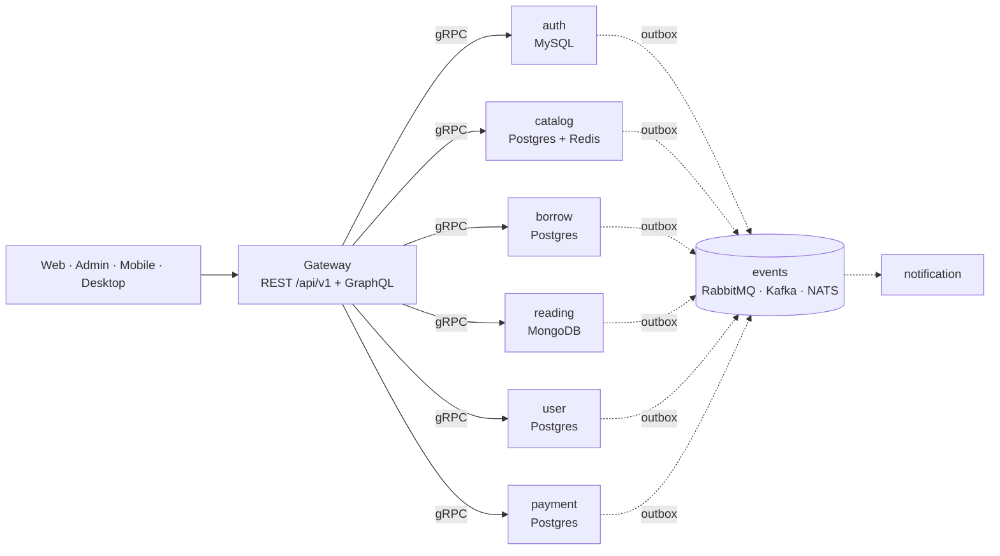
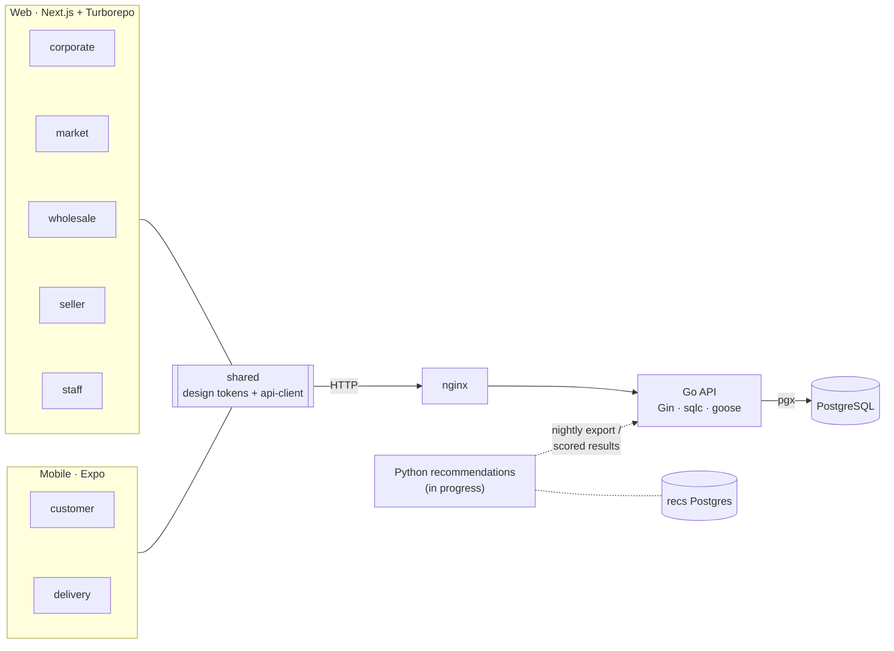
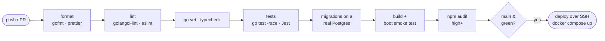

<div align="center">

# Adejare Adedayo

**Backend engineer. I take a system from an empty schema to a box that stays up.**

[](https://git.io/typing-svg)

[](https://linkedin.com/in/adedayo-adejare)
[](https://twitter.com/adedayo_03)
[](mailto:princeadedayo03@gmail.com)
[](https://wa.me/2348034463989)


-00D9FF?style=flat-square)


</div>

---

### `profile.yaml`

```yaml
apiVersion: engineer/v1
kind: Backend
metadata:
  name: adejare-adedayo
  handle: dprince-03
  region: WAT (UTC+1), remote-first
spec:
  languages:   [Go, JavaScript, TypeScript, Python, Java, C]
  apis:        [REST, gRPC, GraphQL]
  data:        [PostgreSQL, MySQL, MongoDB, Redis]
  messaging:   [RabbitMQ, Kafka, NATS]
  infra:       [Docker, Nginx, GitHub Actions, Linux]
  habits:
    - every project starts with a written plan and dated decisions
    - migrations are tested against a real database in CI
    - backups only count once a restore has been tested
```

---

## Systems I've built

### 📚 [Bibliomania](https://github.com/dprince-03/Bibliomania) · library & e-library platform

A Go monorepo that I split from a modular monolith into **a gateway and seven services**, each with its own database.



- A **borrow saga** with idempotent retries and compensation, a **transactional outbox** in every service, and idempotent consumers across RabbitMQ, Kafka and NATS
- API versioning across REST, GraphQL, gRPC and events
- Observability with OpenTelemetry, Prometheus, Loki, Tempo and Grafana
- Clients: Next.js (app, marketing site, admin), a NestJS admin backend, Flutter and JavaFX

### 🛒 [TechShop](https://github.com/dprince-03/TechShop) · multi-app commerce platform

Retail, marketplace and wholesale in one platform.



Only the Go API touches the main database. The recommendation service has its own Postgres and talks to the API through internal endpoints.

- **API:** Go with Gin, pgx, goose migrations and sqlc-generated queries
- **Web:** five Next.js apps (corporate, market, wholesale, seller, staff) in a Turborepo
- **Mobile:** two Expo apps (customer, delivery)
- **Shared:** a design-token package and an API client used by both web and mobile
- **Recommendations (in progress):** a separate Python service with its own database. A nightly job trains the models and hands the scored results back to the Go API

### 🧑‍💻 [DevPrince-Portfolio](https://github.com/dprince-03/DevPrince-Portfolio) · portfolio with a real backend

A Next.js site backed by an Express, Prisma and PostgreSQL API. All content is managed from an admin dashboard that requires **TOTP 2FA**. It's self-hosted with Docker behind Nginx. CD runs only after CI passes on `main`: it deploys over SSH and then applies the Prisma migrations.

### 🍽️ SGC Menu · client project (private repo)

A menu and ordering app for a small catering business, built with Next.js 16, Express 5, PostgreSQL 18 with Prisma, and Redis-backed rate limits. It has encrypted daily `pg_dump` backups with an off-site copy and scripted restore tests, plus uptime monitoring with Telegram alerts.

---

## How I ship

These are the CI/CD stages my main repos use (TechShop, the portfolio and SGC). Each repo runs the stages that fit its stack:



---

## Handbooks I maintain

| Repo | What it does |
|---|---|
| [**Server-Setup**](https://github.com/dprince-03/Server-Setup) | A handbook for running your own infrastructure, from one home-lab box to VPS fleets and AWS/GCP/Azure. Covers Terraform, Ansible, WireGuard, TLS, DNS, 3-2-1 backups and GitHub OIDC deploys, with an exercise at the end of every chapter |
| [**PC-Setup**](https://github.com/dprince-03/PC-Setup) | Playbooks a coding agent can read and run to turn a fresh Windows or Linux machine into a ready-to-use dev workstation (full-stack, mobile, ML/GPU, DevOps, cloud) |

<details>
<summary><b>Earlier work & smaller APIs</b></summary>
<br/>

| Repo | Notes |
|---|---|
| [LMS-API](https://github.com/dprince-03/LMS-API) | My first backend project: a library API with role-based access, search and caching |
| [Automated-Email-Notification-System](https://github.com/dprince-03/Automated-Email-Notification-System) | Scheduled emails sent by cron jobs |
| [News-Aggregator](https://github.com/dprince-03/News-Aggregator) | A full-stack news feed that pulls from several sources |

</details>

---

## Stats

<div align="center">


<sub>The language chart counts bytes across my repos, so the frontends inflate JavaScript. The backends are mostly Go.</sub>

</div>

---

<div align="center">

**Hiring for remote backend work? [Email me](mailto:princeadedayo03@gmail.com).**

</div>
